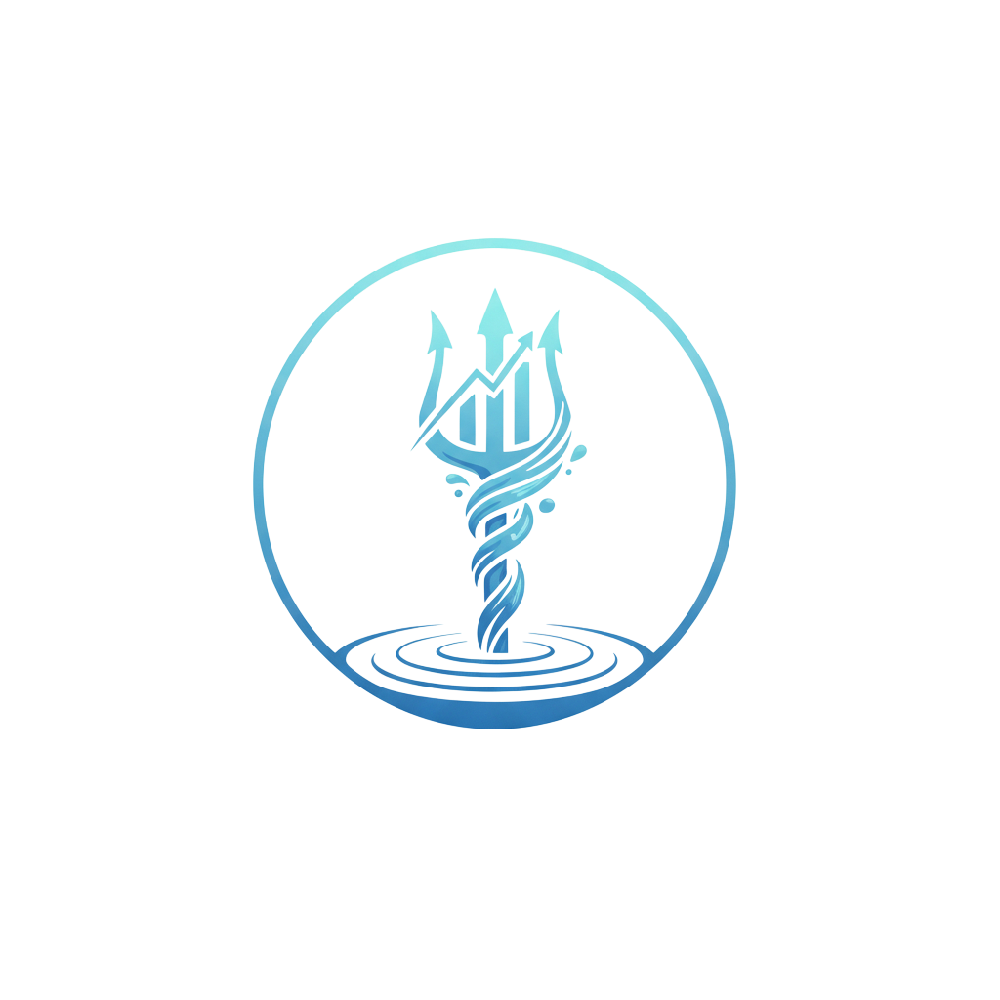

<p align="center">
  
</p>

<h1 align="center">POSEIDON</h1>

<p align="center">
  <b>Photogrammetric Observation and Segmentation for Estimation of Inundation Depth ON-demand</b>
</p>

---

**POSEIDON** is a Python-based scientific tool for automated flood-level
extraction from imagery. It integrates image segmentation and
georectification to detect water surfaces and estimate flood depths across
real-world terrain.

## How it works

1. **Flood events** – `poseidon_utils.EventTracker` downloads Sunny Day
   Flooding Project (SDFP) water levels and lists flood events.
2. **Images** – `poseidon_utils.ImageHandler` pulls event images from the
   SDFP archive and keeps those taken in daylight.
3. **Segmentation** – a Segmentation Gym model labels water in each image.
4. **Grid** – `poseidon_core.GridGenerator` interpolates ground LiDAR onto
   a regular elevation grid for the site.
5. **Rectification** – `poseidon_core.ImageRectifier` projects images and
   labels onto that grid using the camera calibration.
6. **Depths** – `poseidon_core.DepthMapProcessor` finds each pond, takes its
   water surface elevation (WSE) from the ground elevation along its
   waterline, and computes depth = WSE − ground.
7. **Products** – `DepthMapPlotter` maps depths and virtual sensor time
   series; `RoadwayAnalyzer` summarizes flooding on a roadway.

## Repository layout

```
poseidon_core/          Processing pipeline (grid, rectify, depths, plots, roadway)
poseidon_utils/         Shared utilities and data access
  constants.py            Unit conversions and time zones
  naming.py               Camera/timestamp parsing of SDFP filenames
  logging_utils.py        setup_logging() for scripts and notebooks
  zarr_io.py              Atomic ZIP Zarr store helpers
  site_config.py          Per-site YAML configuration loader
  event_tracker.py        SDFP API client and flood event CSVs (shared with flood_event_QC)
  image_handler.py        SDFP image archive access and filtering (shared with flood_event_QC)
  utils.py                log() helper used by the two shared modules
  file_organizer.py       Per-event folder organization
  src/                    C++ label and overlay generators
poseidon_deploy/
  configs/sites/          One YAML per site: camera, grid, CRS, sensors, ROI
  naiads/                 Command-line drivers for each pipeline stage
  hpc_submission_scripts/ LSF job scripts that run the drivers
  analysis/               Cross-event analysis and QC plots
  environment/            Conda environment and lock files
  calibration/            Intrinsic camera calibration notebook
  segmentation/           Segmentation Gym submodule, models, templates
notebooks/              Worked examples of the Python API
tests/                  pytest suite
```

## Setup

### Clone the repository
```bash
git clone --recurse-submodules https://github.com/rtmccune/poseidon.git
cd poseidon
```

### Environment
With an NVIDIA GPU (Linux):
```bash
conda env create --file poseidon_deploy/environment/poseidon-env.yml
```
Without a GPU (any OS; every stage runs on the CPU):
```bash
conda env create --file poseidon_deploy/environment/poseidon-env-no-gpu.yml
```
On a linux-64 HPC system, the explicit spec installs the exact package
builds of the lock file without solving:
```bash
conda create --prefix /path/to/conda/env \
    --file poseidon_deploy/environment/explicit-spec.txt
```
To refresh the lock after editing `poseidon-env.yml` (requires
`conda-lock`):
```bash
cd poseidon_deploy/environment
conda-lock lock -f poseidon-env.yml -p linux-64 \
    --lockfile poseidon-linux-64-lock.yml
python parse_lock.py poseidon-linux-64-lock.yml explicit-spec.txt
```
Then install POSEIDON into the environment:
```bash
conda activate poseidon
python -m pip install -e .
```
Use `python -m pip`, not a bare `pip`: if the environment has no `pip`
of its own, `pip` resolves to the system one (on the NC State HPC, a
Python 3.9 user install), which fails with
`requires a different Python: 3.9 not in '>=3.11'`.

GPU acceleration (CuPy/cuCIM) is optional. Classes take `use_gpu=None` to
use a GPU when one is available, `False` to force the CPU, or `True` to
require a GPU.

### C++ executables
The label and overlay generators need OpenCV (included in the conda
environment). From an activated environment:
```bash
cd poseidon_utils/src
cmake -S . -B build
cmake --build build
```
The executables are written to `poseidon_utils/bin/`. Rebuild them after
upgrading OpenCV or changing their source. Each starts one thread per CPU
given to the job: `POSEIDON_THREADS` when set (stages 03 and 04 set it to
the CPUs requested), else the CPUs the process may run on.

### Segmentation Gym container
From the repository root:
```bash
mkdir -p poseidon_deploy/segmentation/container   # not in a fresh clone
apptainer pull poseidon_deploy/segmentation/container/seg_gym.sif \
    oras://ghcr.io/rtmccune/segmentation-gym-tf:latest
```
The image is about 7 GB. On a cluster, point `APPTAINER_CACHEDIR` and
`APPTAINER_TMPDIR` at project storage first so the download does not
fill your home quota.

## Site configuration

Each monitoring site is described once in
`poseidon_deploy/configs/sites/<site>.yaml`: camera intrinsics and
extrinsics, rectification grid extent and resolution, coordinate
reference system, LiDAR units, virtual sensor pixels, camera
latitude/longitude, and default data paths (LiDAR, basemap, roadway ROI).
Drivers take `--site <name>` instead of these values on every command
line. Add a site by copying an existing YAML; the calibration notebook
prints intrinsics in the YAML format.

```python
import poseidon_utils
site = poseidon_utils.load_site_config("carolina_beach")
```

## Running the pipeline on the HPC

1. Copy `poseidon_deploy/hpc_paths.template.env` to
   `poseidon_deploy/hpc_paths.env` and set `POSEIDON_ENV`, `IMAGE_DRIVE`,
   and `SITE`. Data are read from and written to `data/$SITE/`.
2. Submit each stage from `poseidon_deploy/hpc_submission_scripts/`.

The HPC is moving from LSF to Slurm. Scripts with `#SBATCH` headers are
submitted with `sbatch`, e.g. `sbatch 07_make_rectify.sh`:

* Stage 02 and the segmentation `99_*` scripts use the GPU partitions.
* Stages 03, 04, 07, 08, 09, 10 and 11 run on the CPU, on idle partner nodes
  (`--account=kanarde_cpu --partition=compute_partners --qos=short`, a
  2-hour limit per task). They are limited by file reads and writes, so a
  GPU does not speed them up.

The other stages still have `#BSUB` headers for the LSF `ccee` queue and
are submitted with `bsub < 05_flood_event_setup.sh`. `_common.sh` works
under both. List the accounts and QOS you can use with
`sacctmgr show assoc user=$USER format=Account%20,Partition%20,QOS%60`.

Slurm GPU requests must name a GPU type; the scripts ask for one A100.
Override it, or any other header, on the command line:
`sbatch --gres=gpu:l40s:1 02_segment_lists.sh`. Jobs under two hours can
also use idle partner GPUs with
`sbatch --partition=gpu_partners --qos=short_gpu ...`. Check free GPUs
with `si --gpus` and your jobs with `squeue -u $USER`.

| Stage | Script | Purpose |
|---|---|---|
| 00 | `00_pull_and_save_images.sh` | Copy archive images within each flood event |
| 01 | `01_filter_images.sh` | Keep images taken between sunrise and sunset |
| – | `99_create_job_lists.sh` | Split image folders into job-array file lists |
| 02 | `02_segment_lists.sh` | Segment images (job array) |
| 03 | `03_make_labels.sh` | Convert predictions to label images (job array) |
| 04 | `04_make_overlays.sh` | Draw QC overlays (job array) |
| 05 | `05_flood_event_setup.sh` | Create one folder per event with data and images |
| 06 | `06_prep_rect_grid.sh` | Build the site's elevation grid (once per site) |
| 07 | `07_make_rectify.sh` | Rectify images and labels (one task per event) |
| 08 | `08_calc_depths.sh` | Compute WSE and depth maps (one task per event) |
| 09 | `09_make_plots.sh` | Plot maps and virtual sensor series (per event) |
| 10 | `10_calc_roadway.sh` | Roadway accessibility time series (per event) |
| 11 | `11_summarize_road_stats.sh` | Summarize roadway statistics over events |

Per-event stages are job arrays: set the array size to the number of
event folders (`#SBATCH --array=1-N` or `#BSUB -J name[1-N]`). Rerun one
event with, for example,
`TARGET_EVENT=<event folder> sbatch --array=1 07_make_rectify.sh`
(LSF: `TARGET_EVENT=<event folder> bsub -J one < 09_make_plots.sh`).
Re-running a stage replaces its earlier outputs.

The remaining `99_*` scripts run QC and analysis (overlay comparisons,
accessibility plots, anomaly detection) and segmentation model training.

### Roadway ROIs

Stage 10 summarizes depths on the site's `roi_json`, a LabelMe shape
drawn on a rectified (plan view) image. A plan-view ROI assumes the
rectified road lines up with the plan view. To avoid that assumption,
draw a polygon labeled `roadway` on an original camera image (the camera
view is assumed fixed) and set `camera_roi_json` in the site config.
Stage 10 then also rasterizes that polygon and rectifies it with the
camera model, using the same grid-to-pixel lookup as the labels, so its
ROI is exactly the grid cells that sample road pixels. Each ROI writes
its own `<roi>_*_time_series.csv` and `<roi>_roi_mask.png`.

Stage 11 summarizes both ROIs and runs
`poseidon_deploy/analysis/compare_roadway_rois.py`, which writes to
`data/<site>/roi_comparison/`:
- per-image and per-event differences;
- agreement on the impassable flag;
- bias, MAE, RMSE and correlation of coverage and depth;
- the overlap (IoU) of the two footprints, with a figure.

### Roadway coverage and depth plots

`99_road_access_plots.sh` runs `poseidon_deploy/analysis/access_plotter.py`
after stage 10 and writes everything to `data/<site>/plots/`. Every run
also writes `plot_summary.md` (and `plot_summary.csv`) there. It lists
the run settings and, for each figure, how many images and events it used
and which ones were left out.

**Reading a filename.** Outputs are named `<roi>_<metric>_<plot>_<kind>`,
for example `shell_hill_rd_camera_polygon_MeanDepth_1c_binned_depth_good_only.jpg`:

- `<roi>` is the ROI (the LabelMe JSON's name). `shell_hill_rd_polygon` is
  drawn on the rectified plan view; `shell_hill_rd_camera_polygon` is
  drawn on the camera image and then rectified.
- `<metric>` is how one image's depths over the ROI become one number.
  Only cells labelled as water count. A water cell whose ground sits
  above the pond's water surface has depth 0.
  - `MaxDepth`: the deepest water cell on the ROI.
  - `MeanDepth`: the average depth of the ROI's water cells.
  - `MedianDepth`: the middle depth of the ROI's water cells; less
    affected than the mean by a few deep cells.

  Depths come from the `95_perc` depth maps: each pond's water surface
  elevation is the 95th percentile of the ground elevation along its
  waterline, and depth is that elevation minus the ground.
- **Roadway coverage** is the percentage of the ROI's cells with depth
  above 0.
- `<plot>` is the plot number below. A `b` uses every image with water;
  a `c` uses only images scored good in `segmentation_labels.csv`.
  Images that are unreviewed or scored poor count as "other".

**The plots.** Plots 1–1c have one point per image; plots 2–5 have one
point per event.

| Plot | File ending | Shows | Images and events used |
|---|---|---|---|
| 1 | `_1_evolution_plot.jpg` | Coverage against depth, one dot per image; good segmentations in blue, others in grey | Every image with water on the ROI |
| 1b, 1c binned | `_1b_binned_depth.jpg`, `_1c_binned_depth_good_only.jpg` | **The prediction plot.** See below | 1b: all images with coverage > 0. 1c: good images only |
| 1b, 1c table | `_1b_depth_by_coverage.csv`, `_1c_depth_by_coverage.csv` | The numbers behind the binned plot: the depth lookup table | Same as the plot |
| 1b, 1c logistic | `_1b_reversed_fit.jpg`, `_1c_reversed_fit_good_only.jpg` | A smooth logistic curve of depth given coverage, its median, an 80% band and a 95% confidence band | As the binned plot; images with coverage 0 left out |
| 1b, 1c fit files | `_fit_summary.csv`, `_band_calibration.csv` | Fit parameters with confidence intervals, R², RMSE and MAE; and, by coverage range, the share of images inside the band and below the median, plus the fit's mean error | Same as the fit |
| 2 | `_2_summary_scatter.png` | Each event's peak coverage against its peak depth | One point per event, from its good images (all images without labels); events with none are left out |
| 3 | `_3_depth_cdf.png` | Share of events whose peak depth is at or below each depth | Same events as plot 2 |
| 4 | `_4_depth_pdf.png` | How event peak depths are distributed: a density histogram and a smooth density curve | Same events as plot 2 |
| 5 | `_5_depth_exceedance.png` | Share of events whose peak depth reaches at least each depth | Same events as plot 2 |
| 6 | `_6_sensor_1to1.jpg` | Image depth against the in-situ sensor's depth, with a 1:1 line | Good images with a sensor reading within 5 minutes; image-only events drop out |
| 7 | `<roi>_<Max/Mean/Median>WSE_7_sensor_1to1.jpg` | The same for water surface elevation | As plot 6 |
| 9 | `_9_image_vs_sensor_binned_good_only.jpg`, `_9_depth_by_coverage.csv`, `_9_agreement_summary.csv`, `_9_agreement_by_coverage.csv` | Plots 1c and 8 combined in one figure: in each coverage bin, the mean image-derived depth (blue) sits next to the mean sensor depth (orange), each with its 95% confidence interval and 10th–90th percentile box. Because both use the same images, the per-image error (image minus sensor) is summarized under the plot: bias, MAE, RMSE and r, with event-resampled 95% CIs. The mean error by bin is in `_9_agreement_by_coverage.csv`. One per depth metric | The same images for both: good images with coverage > 0 and a sensor reading within 5 minutes |
| 8 | `<roi>_SensorDepth_8_binned_depth_good_only.jpg`, `_8_depth_by_coverage.csv`, `_8_reversed_fit_good_only.jpg` (+ fit files) | The 1c plots, but with the in-situ sensor's depth for each image instead of the image-derived depth. Coverage still comes from the image. Made once per ROI, since it doesn't depend on the depth metric | Good images with coverage > 0 and a sensor reading within 5 minutes; image-only events drop out |

Plot 8 compares with 1c: if the sensor's depths by coverage bin match the image-derived ones, the image depths are calibrated against an independent measurement. Bear in mind that the sensor measures at one point while the image metric covers the whole ROI.

Where the padded windows of neighbouring events overlap, stage 05 copies the images in the overlap into both event folders. The plots keep each image once, in the event whose flood period (the window without its padding) is nearest. `plot_summary.md` reports how many copies were removed. Set `--padding_hours` if stage 05 used something other than 3.

Because each plot keeps different images, the counts differ from plot to
plot; `plot_summary.md` gives them.

**The binned plot (1b, 1c).** Images are grouped into 10% coverage bins
below 99%. Images at 99% or more (a fully covered road) go in a separate
panel on the right, because once the road is covered, depth can keep
rising while coverage stays at 100%. For each bin:
- the shaded box spans the 10th to 90th percentile of depth, where 80% of
  the images fall;
- the blue circle is the median depth and the orange diamond the mean
  depth, each with a 95% confidence interval from resampling whole events;
- a hollow marker means fewer than 10 images or 3 events, so treat that
  bin with caution.

To predict depth from an observed coverage, find the bin in
`_1c_depth_by_coverage.csv`. Use the median as the typical depth and the
10th–90th percentiles as the expected range. In the full-coverage bin,
coverage no longer pins down depth: read its 10th percentile as roughly
the least depth to expect. Change the binning with `--coverage_bin_width`
and `--full_coverage`.

The logistic plots are a smooth summary, not a prediction tool. Check
their `_band_calibration.csv` first: the share of images below the median
should stay near 0.5, and the share inside the band near 0.8, in every
coverage range. Colors come from `poseidon_deploy/analysis/plot_style.py`,
a colour-blind-checked selection from the feathers palettes.

### In-situ sensor vs camera

`99_sensor_camera_comparison.sh` runs
`poseidon_deploy/analysis/sensor_camera_comparison.py` after stages 09 and
10. Across all events, it compares the in-situ sensor (one point) with the
camera: the virtual sensors and the roadway ROI (the camera-view polygon
when the site sets `camera_roi_json`). Events without sensor readings are
included for the camera sources. Every output is written twice, so the
two sets can be compared:
- `data/<site>/plots/<roi>_sensor_camera_all_images_*` uses every image;
- `..._good_only_*` uses well-segmented images only. This set needs
  `segmentation_labels.csv`.

Both sets contain only daylight images, because stage 05 fills the event folders from the daylight folder. Each image and each sensor reading is counted once, even where event windows overlap. The `n` under each depths column counts observations with water from that source. For the sensor, that's its readings, taken every few minutes over the padded event windows, not images.

The file endings are:

| File | Shows |
|---|---|
| `_depths.jpg` | Every observation showing water, by source: sensor, `VS1`–`VSn`, and the ROI's min, median, mean and max. Boxes show quartiles and median; whiskers the 10th–90th percentiles. Each camera point is coloured by the sensor at that moment: wet (blue), dry (orange; the camera saw water the sensor did not), or no reading within 5 minutes (magenta; includes events the sensor missed). ROI min is usually 0 m, because some water cell is at depth 0 |
| `_timing.jpg` | Per event, when water appeared at each camera location compared with the in-situ sensor's location: VS1–VSn are the pixels of the virtual sensors, and "Anywhere on ROI" is any cell of the roadway polygon. Onset lead is how many minutes earlier water appeared there than at the sensor; end lag is how many minutes longer it stayed. These are differences between places on the road, so they show how much more of an event the camera's wider view captures, not a timing error in either instrument. Measured only within the span of that event's images, since the camera sees only in daylight; hollow points are censored, being wet at the edge of that span |
| `_aligned_start.jpg`, `_aligned_peak.jpg` | Every event's depth over time on a shared clock. In `_aligned_start.jpg`, hour 0 is the buffer start: the event folder name's first timestamp, the event sheet's start minus 3 hours. Every event is included, image-only ones too, and the flood start is dashed at +3 h; use `--start_origin flood` to put hour 0 at the flood start instead. In `_aligned_peak.jpg`, hour 0 is the in-situ sensor's peak, so only events where the sensor recorded water appear. There's one panel per source: sensor (black), VS1–VSn (map colours) and ROI mean (blue). In each, thin lines are single events and the bold line is the mean across events (`--aligned_stat median` for the median), in 15-minute bins with at least 3 events, with the interquartile range shaded. A last panel overlays all the bold lines. By default dry times are left out (`--aligned_dry nan`): lines break when a location is dry, and the bold line is the typical depth among the events with water at that time, so fewer events contribute near onset and recession. Use `--aligned_dry zero` to count dry times as 0 m. The camera lines exist only where (daylight) images do. The numbers are in `_aligned_composites.csv` |
| `_peaks.jpg` | Each event's peak sensor depth against its peak ROI max, ROI mean and deepest virtual sensor, with a 1:1 line; events without sensor readings are in a side panel |
| `_summary.md`, `_summary.csv` | Counts per source: observations, events, events without the sensor, median depth, share while the sensor was dry, median onset lead and end lag, share where the camera was first or later, and camera-only events |
| `_observations.csv`, `_timing.csv`, `_event_peaks.csv` | The data behind the figures |

Virtual sensors keep one colour in every figure: the depth maps, the per-event time series and these comparisons. The colours are VS1 olive, VS2 gold and VS3 pink, set by order in the site config and defined in `poseidon_utils/palette.py`. On the maps, each marker is also labelled `VS1`, `VS2` and so on, so you can match the figures to the sensors' places on the road.

The 1c plots, plot 8 and plot 9 of one ROI share a y-axis, from 0 to just above
the deepest well-segmented image or sensor depth, so they can be compared
directly. On that shared axis, logistic curves that dip below 0 m near 0%
coverage are cut off.

### Publication figures

`99_plots_for_publication.sh` runs
`poseidon_deploy/analysis/publication_figures.py`. It uses well-segmented
images only and writes to `data/<site>/publication/`. Each figure is saved
as PNG and PDF, without a title (captions describe them), with CSVs of
every number shown. The statistics to quote are kept off the figures, in
`<roi>_pub_metrics.md`:
- VS1 against the in-situ sensor: the depth error, and how often they
  agree on whether water is present;
- the mean and median onset lead and end lag for each location;
- for figure 2, the error of each depth metric against the sensor.

Each statistic comes with an event-resampled 95% CI.

- **`<roi>_pub_fig1_aligned_timing`:**
  - **(a)** Mean water depth across events against hours since the start
    of the window, for the in-situ sensor, VS1–VSn and the ROI mean. The
    event sheet's start ("Event Start") is dotted at +3 h. The legend reads
    In-Situ Sensor, VS1–VSn and Mean on Roadway. The in-situ sensor is
    drawn only from the sheet's start to its end, since it defines the
    event; readings in the buffer belong to neighbouring events whose
    windows overlap.
  - **(b), (c)** Onset lead and end lag time per event and camera
    location, with the mean labelled in minutes above each column. Both
    panels share one y-axis, and "Anywhere on Roadway" is the whole ROI.
- **`<roi>_pub_fig2_binned_depth`:** image mean depth, image maximum depth
  and in-situ sensor depth by coverage bin, from the same images. The
  legend calls the two image metrics Mean Roadway Depth in Field of View
  and Maximum Roadway Depth in Field of View.

In both the comparison and publication scripts, the in-situ sensor counts
as wet above 0.02 ft (`--sensor_wet_ft`). That is the event detection
start threshold, so the sensor is wet exactly when the event sheet would
say so.

`publication_figures.py --align peak` puts hour 0 of panel (a) at the
in-situ sensor's peak instead (only events where the sensor saw water).
`--dry zero` counts dry times in panel (a) as 0 m. The in-situ sensor
then reads 0 m outside the event sheet's start and end. Each line then
shows the expected depth at that time across all events, instead of the
mean among only the events still wet. That avoids a U shape, where only
long, deep events remain far from the peak.

#### Two-site figures

`99_combined_publication_figures.sh` runs
`poseidon_deploy/analysis/combined_publication_figures.py`. It puts
Carolina Beach on the left and Down East on the right, or the sites set by
`LEFT_SITE` and `RIGHT_SITE`. Output goes to `data/publication_combined/`.
Each site keeps its own ROI and data folder, and each row of panels shares
its y-axis across the two sites.

- **`combined_fig1_aligned_timing`:** each site's figure 1. The left site
  has panels (a)–(c) and the right site has (d)–(f). Panel (a) is aligned
  on the in-situ sensor's peak, with dry times counted as 0 m and
  30-minute bins (`--bin_minutes`). Every line averages the same events:
  those with a sensor peak and at least one well-segmented image. The
  sensor line is limited to the events the camera lines use. The job log
  prints the count for the caption, and the panel (a) CSV records it as
  `source_events`. A line breaks where a bin has fewer than 3
  events. `<site>_combined_fig1_aligned_timing_event_membership.csv`
  lists, per event and camera location, whether the event is in (a),
  (b)–(c), both or neither, and why. The run log prints a count per
  reason. The single-site script writes the same table as
  `<roi>_pub_fig1_aligned_timing_event_membership.csv`. There, 15-minute
  bins, every sensor event and no legend counts stay the defaults
  (`--bin_minutes`, `--sensor_with_camera`, `--event_counts`).
- **`combined_fig2_depth_by_coverage`:** for each site, the mean-depth 1c
  plot sits above figure 2. The 1c plot shows the logistic fit of depth
  on coverage, with its median and 80% prediction band. The left site has
  (a), (b) and the right site has (c), (d). Both rows use the same
  images: well segmented, with water on the road and an in-situ sensor
  reading within 5 min. The run log prints each site's image and event
  counts. The depth axis of (b) and (d) starts just below 0 m.

`event_funnel.md` counts the events left after each step, from the event
sheet to each panel, for both sites. The daylight steps need stage 01's
`abbr_flood_events_daylight.csv` in the site's data folder.

Each site's `<roi>_pub_metrics.md` still holds the statistics to quote,
because the alignment does not change them.

### Example event figure

`99_example_event_figure.sh` runs
`poseidon_deploy/analysis/example_event_figure.py` and makes one figure
per site. Three panes show the rising leg, the peak and the falling leg
of one flood event. By default they are depth maps drawn exactly as
stage 09 draws them (basemap, depth scale and virtual sensors); with
`--pane image` they are the camera image with water shaded. Below them
is the event's water depth time series:
- the in-situ sensor;
- the mean depth on the roadway, from the images;
- each virtual sensor, in its map colour.

Each pane is framed in a colour that matches a dashed line on the time
series.

The event and the three moments are chosen from well-segmented images
with water on the roadway. Use `--events` and `--times` to choose your
own; the output CSV lists the moments shown.

### Site summary table

`99_site_summary_table.sh` runs
`poseidon_deploy/analysis/site_summary_table.py`. It makes the paper
table of flooding at each site: in-situ sensor rows (from
`flood_events.csv`) and image-derived rows (from stage 10's roadway
CSVs, publication ROI). The output, in `data/publication_combined/`, is:
- a rendered table (PNG, PDF and SVG), in the figure colours;
- a CSV of the unrounded values;
- a booktabs `.tex` table;
- a `.md` file that defines every row.

The image rows differ from stage 11's summary:
- **Capped intervals:** each image stands for at most 12 minutes, so an
  overnight gap is not counted as flooded time.
- **Overlapping windows:** images in two event windows count once.
- **Averages:** event means are over events with water.

The image rows include events without sensor data, and a row counts
them, because those extra events are part of what the imagery adds.
Each run also writes `site_summary_table_good_only.*` from
well-segmented images only, for comparison.

### Methods figure

`99_methods_figure.sh` makes the material for the methods process diagram:
- **`methods_figure_assets.py`** exports example panels for one
  well-segmented image to `data/<site>/methods_figure/assets/`. By default
  it picks an image whose roadway coverage is near 60%; choose another
  with `--event` and `--timestamp`.
  - Camera view: the original image, the segmentation overlay, a
    class map, a water mask and the camera-view roadway polygon.
  - Plan view (north up, one shared size, so they stack): the LiDAR
    elevation grid, the rectified image, the rectified water mask, and
    the depth map with an SVG colour bar. Also the depth map with the
    roadway outline and virtual sensors.
- **`methods_process_diagram.py`** writes `process_diagram.svg`, which
  links those panels. Panel (a) is a workflow overview, (b) zooms in on
  segmentation and (c) on georectification and depth. Each part is a
  named Inkscape layer, and all text is live, so the figure can be
  finished in Inkscape. Missing panels appear as labelled placeholders.

### Site description figure

`poseidon_deploy/analysis/site_description_figure.py` draws:
- North Carolina with both sites marked;
- each community on aerial imagery;
- each site's elevation grid, with the camera and its field of view,
  the roadway region and the virtual sensors;
- a photo from each camera.

The maps have zebra frames, scale bars and north arrows, from
`map_decorations.py`, which is adapted from the shift repository.

It runs in two steps, because compute nodes have no internet:
1. **Download the layers** where there is internet, e.g. locally:
   ```bash
   python poseidon_deploy/analysis/site_description_figure.py fetch \
       --sites carolina_beach down_east --layers_dir data/site_figure/layers
   ```
   This saves state boundaries and basemap / imagery GeoTIFFs.
2. **Draw the figure** offline. Either run
   `site_description_figure.py render` locally, or copy the layers to
   the HPC and submit `99_site_description_figure.sh`.

The default layout is landscape:
- **Left:** eastern North Carolina (a), with each site's box in its own
  colour. Below it are the two communities, (b) and (c) in `--sites`
  order, each joined to its box by dashed lines in that colour.
- **Right:** one row per site. The elevation grids (d), (e) are framed
  in the site's colour, and the photos (f), (g) sit beside them.

`--context_extent` changes the state map's extent, and
`--layout vertical` gives a portrait version with the whole state.

For each site's photo, the render step uses the first of these it finds:
1. the image the camera roadway polygon was drawn on, anywhere under
   `data/<site>/`;
2. a `data/<site>/CAM_*.jpg`;
3. the middle image of `images/daylight_all_events/`.

Or choose the photos with `--photos LEFT RIGHT`.

The render step needs each site's `data/grids/shared_grid_<site>.npz`.
Stage 06 builds it in seconds from the LiDAR, locally too. The figure is
saved as PNG, PDF and SVG (editable in Inkscape), and `attribution.txt`
holds the imagery credits for the caption.

### Events without sensor data

Stage 05 needs `flood_events.csv`, the sensor readings inside each event.
When the event sheet comes from QC or was edited by hand, rebuild it from
the sheet, keeping the sheet's event numbers:
```bash
python poseidon_deploy/naiads/run_pull_event_series.py \
    --abbr_events_csv data/down_east/abbr_flood_events.csv
```
This needs SDFP API credentials (`SDFP_API_USERNAME` and
`SDFP_API_PASSWORD`, or `mysecrets.py`). Events with no readings, such as
floods confirmed only from images during a sensor outage, are listed and
left out. Stage 05 still builds their folders from the images, and every
later stage runs on them; plots show the virtual sensors without an
observed series.

### Reviewing segmentations

`99_image_overlay_comparison.sh` stitches each daylight image beside its
overlay into `images/stitched_comparisons/comparison_<image name>`. To list
the images not yet scored in a review CSV (`Filename`,
`Segmentation_Score`), run from the repository root:
```bash
python poseidon_deploy/analysis/list_unreviewed_images.py \
    --site down_east --labels data/segmentation_labels.csv
```
This writes `data/down_east/images_to_review.txt` and logs reviewed and
remaining counts for the daylight and `all_events_during_FOV` folders.

## Example notebooks

* `notebooks/flood_event_pull.ipynb` downloads SDFP water levels for the
  Carolina Beach and Down East sensors and builds each site's flood event,
  outage, and plot outputs (needs SDFP API credentials).
* `notebooks/poseidon_workflow.ipynb` runs grid generation, rectification,
  depth estimation, and roadway analysis on one event with the Python API.

`event_tracker.py`, `image_handler.py`, and `utils.py` in `poseidon_utils`
are kept identical to the copies in the flood_event_QC repository; change
them in both places.

## Tests

From the repository root:
```bash
python -m pytest
```
GPU tests run only when CuPy can use a local GPU (`python -m pytest -m gpu`
selects them). Sun-position tests need `astral`, and the C++ tests need the
built executables (or `POSEIDON_BIN=/path/to/bin`).

## Code style

Code follows PEP 8 (79-character lines) with numpy-style docstrings,
checked by `ruff` using the configuration in `pyproject.toml`:
```bash
ruff check .
```
